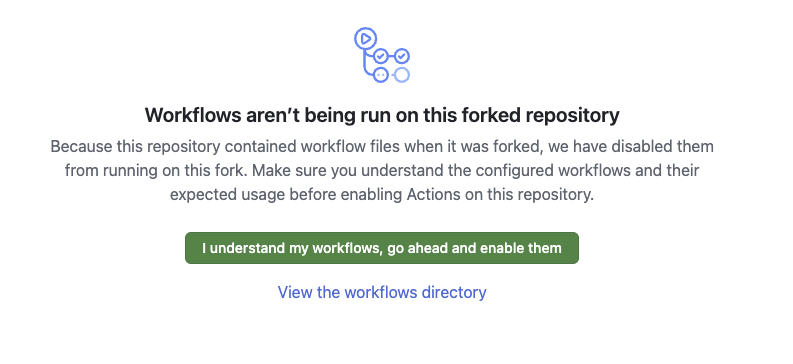

# gh-classroomless — a self-hosted GitHub Classroom replacement

### Why this exists
- **GitHub Classroom shuts down 2026-08-28.** GitHub/Microsoft is retiring it and pushing everyone onto
  third-party "partner" products.
- **So we built our own** — a clean, Classroom-like flow we fully control. No vendor, no lock-in.
- **Less, but solid.** We dropped Classroom's flaky extras and kept only the three things we actually
  use: **hand out assignment repos**, **grade**, and a **who-has-what list**.
- **Issue-driven.** A student clicks a link → opens a pre-filled Issue → a GitHub Action does the rest
  (creates a private repo from a template, sends the invite, logs it). **No server.**
- **Deploy once, update by fork.** Stand up your school in minutes; pull future improvements with a
  fork sync. New features always welcome.

---

## Deploy this for your school

`classroom` (**public**) + `classroom-admin` (**private**) are the two repos per school. To run it for
**your** school, create both and do the one-time setup below. (Each school's public README is
the student-facing page; this guide is for the instructor/deployer.)

## 1. Create the two repos in your org

The two are made **differently** — `classroom` is a **fork** (so you can pull our code fixes),
`classroom-admin` is **generated from the template**.

| Template (canonical, in `gh-classroomless`) | Your repo | How | Visibility |
|---|---|---|---|
| `gh-classroomless/classroom-template` | `<your-org>/classroom` | **fork** | public |
| `gh-classroomless/classroom-admin-template` | `<your-org>/classroom-admin` | **template-generate** | **private** |

```bash
# classroom = FORK (shares history → updatable later; see "Updating" below)
gh repo fork gh-classroomless/classroom-template --org <your-org> --fork-name classroom --clone=false
# classroom-admin = TEMPLATE-GENERATE, and it MUST be private (see the warning below)
gh repo create <your-org>/classroom-admin --template gh-classroomless/classroom-admin-template --private
```

> ### ⛔ Generate the admin repo. Never fork it.
> Both templates are public, so GitHub will happily let you fork either one — and **a fork of a public
> repo is public by default.** Your `classroom-admin` accumulates **student names and emails** (plus
> exam access codes if you use them), so a forked admin is a PII leak with no warning attached. Use
> `--template … --private` (or "Use this template" → Private) every time, and check the padlock
> afterwards. The `--private` flag above is not decoration.

Why the difference in method: only a fork shares history with upstream, which is what makes "Sync
fork" and `git pull` work — so `classroom` is a fork and stays updatable. The admin repo is a
one-time copy: **we ship no update path for it**, by design (we cannot reach into your org). If we
later change an admin workflow, you re-copy the file yourself. That is the whole maintenance contract:
**you own your deployment after this page.**

## 2. ⚠️ Enable workflows — a fork starts with Actions DISABLED

Because the repo had workflow files when forked, GitHub disables them on your fork until you approve.
Open each repo's **Actions** tab and click the green button. **Nothing runs until you do this.**

**There is no API for this** — it is the one step nobody can script for you, which is exactly why it
gets skipped. (Forks also start with the **Issues** tab off; if you used `ops/deploy.sh` that is
already handled, otherwise see step 6.) Step 6 exists to catch both.



Do it on **both** `<your-org>/classroom` **and** `<your-org>/classroom-admin`.

## 3. Add your `config.json`

Each school carries exactly **one** `config.json` at the repo root — its courses and assignments.
Copy `config.example.json` to `config.json` and fill it in (edit on the GitHub web UI, or clone).
On every push to `config.json`, the **gen-forms** Action rebuilds the `request-<course>.yml` forms
automatically — so a request form exists for each course you list.

```jsonc
{
  "instructor_username": "your-login",
  "courses": {
    "cs101": {
      "semester": "sp26",
      "assignments": {
        "A00": "cs101-template-repo-name",                 // normal: value = the template repo to clone
        "Q1":  { "template": "cs101-exam-repo",            // exam: time-gated
                 "available_from": "2026-06-29T00:00:00-07:00",
                 "available_until": "2026-08-15T23:59:59-07:00" }
      },
      "student_repo_pattern": "cs101-{semester}-{assignment}-{username}"
    }
  }
}
```
Assignment **template repos** (the code/tests students get) live in **your org**, not here.

## 4. Secrets (on `<your-org>/classroom`)

Two secrets. **`JOIN_CODE`** is just your class code. **`ORG_PAT`** is a token you must create first:

**Create the `ORG_PAT` (one-time):**
1. GitHub → your avatar → **Settings** → **Developer settings** (bottom of the left menu) →
   **Personal access tokens** → **Tokens (classic)** → **Generate new token (classic)**.
2. Note: `ORG_PAT for <your-org> classroom`. Expiration: 1 year (set a reminder — an expired token
   silently breaks `request`).
3. Scopes — check: **`repo`** (full), **`workflow`**, and **`read:org`** (under *admin:org*).
4. **Generate token** → copy the `ghp_…` value (shown once).

The token must belong to someone who can **create repos in `<your-org>`** (an org owner). Workflows
then act as that person.

**Set both secrets:**
```bash
gh secret set JOIN_CODE --repo <your-org>/classroom            # then type/paste your class code
gh secret set ORG_PAT   --repo <your-org>/classroom            # then paste the ghp_… token
```
`ORG_PAT` lets the workflows create student repos, add the student as a collaborator, and write the
private admin repo. Never put either in `config.json` (it's public). Don't paste the raw token on a
command line where it lands in shell history — the interactive `gh secret set` (no `--body`) prompts safely.

## 5. How `classroom` ↔ `classroom-admin` are linked

- **By name:** workflows write to `${{ github.repository }}-admin` — so the private repo **must** be
  named `<your-org>/classroom-admin` (matching the public `<your-org>/classroom`).
- **By token:** they reach it with `ORG_PAT` (step 4).
- **PII boundary:** student name/email + the report live **only** in the private admin repo. The
  public `classroom` repo holds no PII.

## 6. Smoke-test — prove it runs, before any student sees a link

Everything is in place now. Nothing has actually been *run*, so run it yourself once:

1. Open the **Register** link below with your own `JOIN_CODE` → the bot should reply
   "Registered as …" and close the issue.
2. Open one **Request** issue → within ~1 minute the bot should reply with a repo link and an invite.
3. No reply? Work back through: **workflows approved (step 2)** → `ORG_PAT` set (step 4) →
   `config.json` present (step 3).

Step 2 is the usual culprit — it is the one thing here with no API, so it is the one thing that gets
forgotten. (Issues, the other fork default, is already handled: `ops/deploy.sh` switches it on right
after the fork. If you created the repos by hand instead, turn it on with
`gh api -X PATCH repos/<your-org>/classroom -F has_issues=true` — with Issues off there is no form to
open at all.)

> ⚠️ **Do not trust the API to tell you this is working.** `actions/permissions.enabled` reads `true`
> on a repo whose workflows are still unapproved *and* on one with Issues switched off. It is blind to
> both. The only proof is a real issue that gets a real reply.

## 7. Post the Canvas deep-links (per course)

Only after the smoke test passes.

```
Register: https://github.com/<your-org>/classroom/issues/new?template=01-register.yml&join_code=<CODE>
Request:  https://github.com/<your-org>/classroom/issues/new?template=request-<course>.yml
My repos: https://github.com/<your-org>/classroom/issues/new?template=03-myrepos.yml
```

## Updating later (you're a fork)

When the upstream template ships a code fix, pull it — your `config.json` and generated forms are
preserved (the upstream doesn't contain them, so a merge can't touch them):
```bash
# "Sync fork" button on the repo, or:
git pull https://github.com/gh-classroomless/classroom-template.git main
git push
```

**This covers `classroom` only.** `classroom-admin` is a one-time copy, not a fork — it shares no
history, so there is nothing to sync and **we have no way to push anything into your org.** If an
admin workflow changes upstream, copy the file over yourself from
`gh-classroomless/classroom-admin-template` (`.github/workflows/`). Watch that repo (or check it each
term) if you want to know when that happens. **Everything after deployment is yours to run** — that is
the deal, not an oversight.

## The dashboard

On `<your-org>/classroom-admin`: **Actions → report → Run workflow** → read `REPORT.md`.
